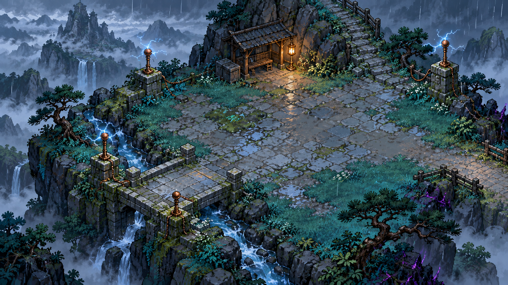
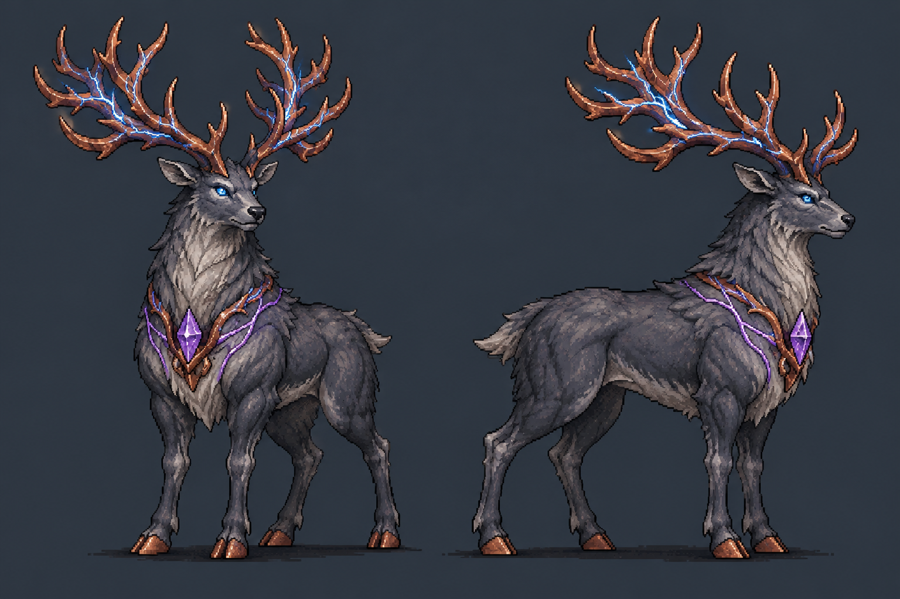

# 雷雨高原 D2 概念美术

2026-10-27，使用内置 imagegen 生成四张独立概念图，已逐张检查。完整原始提示保存在 [prompts.json](prompts.json)。玩法与制作要求以 [详细设计](../../Docs/THUNDER_PLATEAU_DESIGN.md) 和 [两房原型规格](../../Docs/THUNDER_PROTOTYPE_SPEC.md) 为准。

| 文件 | 内容 | 用途与进入制作前的调整 |
| --- | --- | --- |
| [rainy-highland-concept.png](rainy-highland-concept.png) | 雨中草坡、灯棚、铜质引雷节点、石桥与山路 | 氛围与材质参考。当前是斜俯视环境概念，正式玩法需对齐现有正交镜头，拆成地面、边缘、掩体和门，重新审核通行空间 |
| [stormwatch-stag-concept.png](stormwatch-stag-concept.png) | 巡雷巨鹿的前侧与侧面造型，铜角、湿灰毛、胸前紫色束缚 | Boss 统一造型依据。雷石受束缚时偏紫，解放后回到蓝白；后续需要四足步态与攻击动作，不把角的外接矩形当受击体 |
| [charge-moth-concept.png](charge-moth-concept.png) | 蓄雷蛾、灰翼与蓝白腹囊 | 锁定小怪剪影和亮腹前摇；后续简化细纹，按实际小尺寸制作拍翼图集 |
| [storm-spearguard-concept.png](storm-spearguard-concept.png) | 巡雷枪卫、雨披、铜叉、断引雷杆 | 角色与持叉关系参考；后续对齐少年像素密度，拆武器与手部动作，检查左右步态 |

四张图都有背景，是概念原稿，未导入 Unity Resources，也不是透明精灵、动画帧或可直接铺设的 Tilemap。生产阶段先做同镜头小尺寸对照与单方向动作预览，再扩展四向；CG 和对话图可使用较高精度插画。

