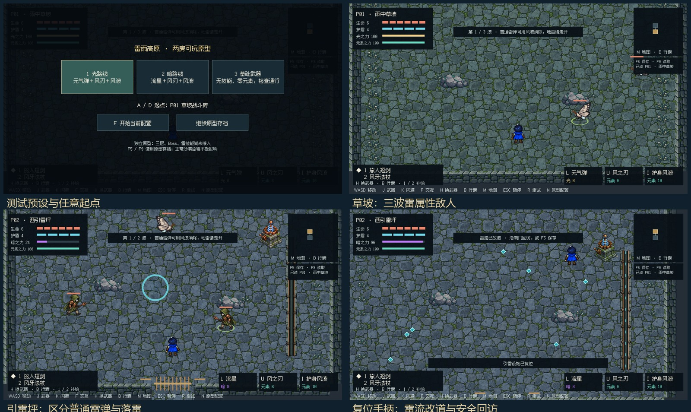

# 雷雨高原两房原型 S1 美术

本轮八项素材使用内置 imagegen 生成并已导入 Unity：floor、rock、node、moth、guard、wall、grass、channel。精确提示分别保存在 [prompts.json](prompts.json) 与 [decor-prompts.json](decor-prompts.json)，文件名带 original 的 PNG 是未改动的生成原稿。

运行素材位于 Assets/NakiPrototype/Resources/NakiArt/ThunderS1。源图按实际内容切分，不假设生成结果一定符合等宽网格；[atlas-layout.json](atlas-layout.json) 保存 14 帧蛾和 12 帧枪卫的矩形与锚点。蛾按腹部位置对齐，枪卫按脚底对齐，左右使用镜像。当前没有正式四向动画组。

地图由平铺地面、独立墙体、低石、草丛、门与引雷装置拼接；导能槽使用独立图片与能量粒子，装置本身已绘有铜手柄。没有将概念图直接铺作整张碰撞地图。图片导入明确为 Texture2D，避免新图被误判为 Cubemap。

Unity 运行画面与动画预览已保存于此目录；试玩方式见 [S1 说明](../../Docs/THUNDER_S1_PLAYTEST.md)。D2 概念与正式三层剧情设计继续作为后续制作依据。

[枪卫向右步态](StormGuard-right.gif) · [枪卫向左步态](StormGuard-left.gif) · [蓄雷蛾拍翼](ChargeMoth-right.gif)
