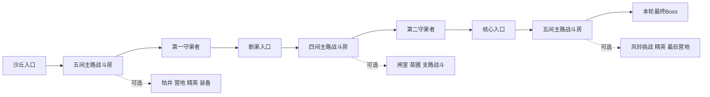

# 沙漠第一章房间与事件设计

设计阶段：D1，2026-10-27。章节名暂定《长风携雨》。原沙漠主流程为 V12；独立闸室样板 S1 已实现，见 [试玩说明](GATEHOUSE_PLAYTEST.md)。本稿的 39 房重排、四个完整支线和 Boss 剧情尚未整体接入。原运行规则见 [V12 修改说明](DESERT_V12.md)。

第一章的完整体验是：少年在村口见到缺水的生活，沿旧渠学习战斗与风的用法，发现古代治水设施受到风石扰乱，最终取回风石，让雨云重新越过山口。玩家沿门和通道探索，途中能帮助居民、改善回程路线、获得不同装备，并在战后看见自己行动的结果。

配套制作稿：[闸室样板](DESERT_GATEHOUSE_SAMPLE.md)、[三种 Boss 对白与演出](DESERT_BOSS_STORY.md)、[雷雨高原概念](THUNDER_PLATEAU_CONCEPT.md)。四份文档分别对应章节结构、首个可玩样板、沙漠演出和第二岛方向。

## 制作范围与基本规则

保留三层共 39 个房间的规模，先改变空间、事件和反馈。以下配额是下一阶段的设计目标，并非 V12 当前随机分配的房型数量。

| 区域 | 入口 | 普通战斗 | 精英 | 事件 | 休憩 | 装备补给 | 层末战 | 总数 |
| --- | ---: | ---: | ---: | ---: | ---: | ---: | ---: | ---: |
| 沙丘边缘 | 1 | 6 | 1 | 1 | 1 | 1 | 1 守渠者 | 12 |
| 断渠遗迹 | 1 | 6 | 1 | 2 | 1 | 1 | 1 守渠者 | 13 |
| 古渠核心 | 1 | 7 | 2 | 1 | 1 | 1 | 1 最终 Boss | 14 |
| 合计 | 3 | 19 | 4 | 4 | 3 | 3 | 3 | 39 |

每轮生成这些房间身份，再随机选择兼容的轮廓、门位、摆设与连接。身份和进度在本轮内固定；回访不刷新敌人、补给、事件结果或学习计数。

每层保证一条可完成的主路，另有可选支路与少量环路。三层主路目标共 20 间房，完整探索为 39 间；两者的实际用时等 V12 试玩后测量。支路不能成为换层、拿风石或保住主要结局的隐藏前提。

光、暗主属性不限制关心居民或修复环境。元素结晶只补元素之力，事件不自动给暗之力。暗线尚未开放，本稿以当前光线实现教学，并保留以后接入暗线教学的位置。

## 三层的空间与情绪

| 区域 | 空间语言 | 颜色与动态 | 敌人组合重点 | 本层完成后的变化 |
| --- | --- | --- | --- | --- |
| 沙丘边缘 | 村口、半埋庭院、浅渠、宽阔柱厅 | 暖砂岩、蓝披风、少量干草；旱风与细沙 | 砂蝎追近、枪卫直刺；逐种认识攻击 | 井口风铃开始摆动，通往旧渠的检修阶梯开放 |
| 断渠遗迹 | 狭长渠道、侧廊、闸室、分水池 | 灰白石板与褪色青绿水位线；机关声 | 枪卫卡位、滚蓬冲刺、沙鹞远程骚扰 | 总闸解除锁定；若完成修渠支线，可见少量存水缓缓通过 |
| 古渠核心 | 大型导风井、环形庭院、守卫大厅 | 暗青石面、铜构件、冷色风纹；共鸣声 | 组合战、精英读招、Boss 场地利用 | 风石脱离后异常旋流停止，云层开始越过山口 |

干涸水道本身可行走。可通行的浅水与不可通行的深水必须使用不同边缘、深度和声音，不能只靠颜色判断。第一批样板不加入滑倒、溺水、流体模拟或随机沙暴伤害。

## 主路与技能顺序

房间编号表示身份，不表示整齐排列的选关菜单。下面描述必须保证的体验顺序，实际连接仍在地图中生成。

主路第 3 个不同战斗房后开放元气弹，累计第 6 个开放风之刃，第 10 个开放护身风波。第一层主路有五间普通战斗房和一名守渠者，因此风刃最迟在第一层末开放；第二层主路第四间普通战斗房后，累计达到十间，风波可在第二守渠者之前学习。先走支路会更早满足条件。

风铃台需要靠近按 F 学习。忽略后仍可在后续安全房学习，多个待学技能按顺序领取，不因离开原房间而消失。第一批不使用“必须持有风武器”或“必须消耗法力”才能打开的主路门。

拿到碎片前，少年借风铃台和旧渠导风装置感知环境中的微弱风流，学会引导与释放；取得风石后才获得更稳定、能随身带往其他岛屿的风元素共鸣。风技能的早期学习与最终强化由此衔接。

## 第一层的十二个房间

主路为 S01 → S02 → S03 → S04 → S05 → S06 → S07。支路可形成环路，但不得绕过首次敌人教学；不把未知房型在小地图上提前全部公开。

| 编号 | 房间与身份 | 空间及战斗设计 | 交互与完成反馈 |
| --- | --- | --- | --- |
| S01 | 枯井村口，入口 | 有井、停转的水车、耐旱幼苗；保留宽阔练习地 | 老人与孩子给出缺水线索，远处旧渠入口可见；无强制长对话 |
| S02 | 断墙练剑场，战斗 1 | 宽院、两段短墙；两波砂蝎，首次出现时单只先行预警 | 认识移动、攻击、闪避和结晶；战后门锁熄灭 |
| S03 | 晒绳小院，战斗 2 | 错位柱与侧向空地；枪卫先单独出现，再与砂蝎组合 | 地面直线预警清晰，柱子可用于挡弹和绕行 |
| S04 | 风蚀柱厅，战斗 3 | 中央空地、左右两组柱；保持一条宽退路 | 清理第三个战斗房后出现元气弹教学台；出口不会被教学台占用 |
| S05 | 半埋货场，战斗 4 | 两组矮掩体、交错通路；两种普通敌人 | 在接近与远程出手之间换节奏；补给装饰不伪装成碰撞墙 |
| S06 | 旧井外庭，战斗 5 | 入口缓冲区与三处分散掩体；加入一次滚蓬教学 | 滚蓬先在空地蓄力，再加入混编；落点避开门和玩家 |
| S07 | 守井石室，层末 | 第一守渠者“枯井石卫”；中央有可绕行空间 | 击败后出现风刃教学台与前往第二层的阶梯；保留 V12 守渠奖励 |
| S08 | 商队残垣，可选战斗 | L 形院落，两波已认识的敌人；清理后形成回程环路 | 标准结晶奖励，回访保持清理状态 |
| S09 | 露囊洞庭，可选精英 | 强化砂蝎与少量枪卫；精英入场单独给预警 | 强化敌人掉精英结晶，房间不额外自动补满资源 |
| S10 | 井底余凉，事件 E01 | 安全井台与可检查的旧储水罐 | 选择如何分配找到的清水，村民与道具状态随结果变化 |
| S11 | 避风旅棚，休憩 | 帆布、灯与一条通向旧渠的地图线索 | 保留 V12 一次性休憩恢复；可看装备建议，不加入货币商店 |
| S12 | 旅人遗物，装备补给 | 掩体后的小储物间，物品轮廓清楚 | 从免费长矛或短弓中择一，提供零元素消耗的后备装备 |

第一层不会混入雷印精英。雷印符号可以作为极少量背景线索，不能让玩家在认识基础战斗前承受雷区和多种新敌人的组合。

## 第二层的十三个房间

主路为 T01 → T02 → T03 → T04 → T05 → T06。入口与第一层阶梯双向连接；返回上层要显示目的层数，不能自动把玩家再次送回。

| 编号 | 房间与身份 | 空间及战斗设计 | 交互与完成反馈 |
| --- | --- | --- | --- |
| T01 | 旧渠检修口，入口 | 横向宽台与单独的返程阶梯 | 目的提示为返回第一层；解释水位线与导风槽 |
| T02 | 两岸回廊，战斗 1 | 干渠两侧有并行道路和两个交叉口 | 沙鹞先单独展示远程前摇，再与砂蝎混编；脚下阴影清楚 |
| T03 | 落闸庭，战斗 2 | 闸门装饰位于场地外缘，中段为可绕行掩体 | 枪卫与滚蓬组合；机关不会在战斗中突然夹人 |
| T04 | 交汇池，战斗 3 | 四向渠道汇入中央空池，两个侧台 | 鼓励风刃贯穿与绕掩体；不强制消耗风技能通关 |
| T05 | 风轮廊，战斗 4 | 宽窄交替，但每个狭口有第二条绕路 | 无支路也会在此达到风波学习条件；战后保留练习空地 |
| T06 | 分水总闸，层末 | 第二守渠者“失衡水轮守卫”，两侧实体掩体 | 胜利解除设施总锁，教学保底与前往第三层阶梯开启 |
| T07 | 断桥下渠，可选战斗 | 视觉断桥在上层，地面有明确可行走的渠道底 | 走地面路径绕行，不需要跳跃系统；入口不能刷敌 |
| T08 | 空罐库，可选战斗 | 大小罐体排列有留白，少量明确可破坏物 | 罐体破坏与永久石柱分开表现；第一批可先只做静态版本 |
| T09 | 雷印试验庭，可选精英 | 一只雷印沙鹞先展示地面落雷，再加少量普通敌人 | 文案解释风可打断蓄力、风波不能清除地面雷区 |
| T10 | 封闭闸室，事件 E02 | 能看到远处闭合的检修栅门、阀门和两条现有路线 | 疏通后打开可选捷径；无钥匙、无元素消耗，不改变主路可达性 |
| T11 | 旧渠苗圃，事件 E03 | 石槽、干土、耐旱树苗和空水位刻线 | 为树根清开入水口；初次只清沙，后续随水源状态变化 |
| T12 | 机匠营地，休憩 | 工具、熄火炉与可坐的石阶 | 保留一次性休憩恢复；机匠说明闸室用途与附近捷径 |
| T13 | 旧渠工坊，装备补给 | 三个物品展示位，明确属性与元素消耗 | 从风纹剑、旧木法杖、裂岩重剑中择一；背包满时复用替换界面 |

第二守渠者在剧情上是设施守卫，不持有另一片风石。V12 目前可能复用最终 Boss 的外形与招式，下一步先补名称与配色区别，独立水轮造型列入后续美术任务。

## 第三层的十四个房间

主路为 U01 → U02 → U03 → U04 → U05 → U06 → U07。支路奖励不得让最终 Boss 的必要应对依赖某把随机武器。

| 编号 | 房间与身份 | 空间及战斗设计 | 交互与完成反馈 |
| --- | --- | --- | --- |
| U01 | 核心前庭，入口 | 铜质风槽与完整入口缓冲区 | 告知设施已解除总锁，异常风源仍在深处；能返回第二层 |
| U02 | 导风井，战斗 1 | 两个宽环道绕中央不可行走风井 | 近战逼位与远程骚扰组合；风井边界有实体护沿 |
| U03 | 铜环回廊，战斗 2 | 弧形铺装，实际碰撞使用清晰的分段边缘 | 分波从两侧进入，保留一个未封堵的撤退方向 |
| U04 | 守卫列厅，战斗 3 | 交错柱阵与一条可绕行外圈 | 一次只安排一只重甲石卫承担主要范围攻击 |
| U05 | 风纹祭庭，战斗 4 | 分散掩体与中央空区，三波已有敌人组合 | 检验护盾、元素补给、免费武器和风波的使用节奏 |
| U06 | 核心外庭，战斗 5 | 接近 Boss 场地的尺度，掩体外形一致 | 最后一场主路混编，清理后显示最终守关方向 |
| U07 | 风石核心，最终 Boss | 根据本轮持石者选择专属竞技场 | 风蝎、巨像、猿王三选一，得到唯一风石并触发战后演出 |
| U08 | 废弃导风仓，可选战斗 | 两个相连的小区间，共用清房状态 | 从不同方向进入仍保持同一波次进度 |
| U09 | 埋沙中庭，可选战斗 | 开阔中央与低矮外缘掩体 | 主要压力来自横向移动，避免继续堆密集柱阵 |
| U10 | 古卫封室，可选精英 | 重甲石卫与少量枪卫，收招破绽明显 | 精英结晶和支路线索，回访不重刷 |
| U11 | 雷印观测台，可选精英 | 强化雷印沙鹞与滚蓬组合，圆形落雷区可避开 | 延续风克雷教学，为下一岛埋下设施线索 |
| U12 | 回声风铃，事件 E04 | 无伤害练习台，固定可见目标 | 可选风技能练习；免费练习能量不带出房间 |
| U13 | 最后旅棚，休憩 | 石壁背风处能看到远方核心，声音稍缓 | 一次性休憩与简短提醒；不是自动补满所有药剂 |
| U14 | 守渠遗藏，装备补给 | 两个风属性武器展示位 | 从风牙法杖、守渠风矛中择一；数值沿用 V12 |

## 四个事件的完整规则

所有事件先显示可交互物和 F 提示。打开对话或选择界面时暂停战斗与计时；取消只关闭界面，不替玩家选择。确认后先提交本轮事件结果，再播放演出和发奖励。重复 F、回访、再次进房都不能重复领取。

### E01 井底余凉

触发：在 S10 清理井台旁的沙堆，发现一罐仍封着的清水。罐子是事件物品，不占武器栏，不消耗已有药剂。

老人：“井边还有一罐没开封的水。带上吧，前面的路长。”

少年可以选择“先补充旅途用水”或“把这罐留给村里”。选择前显示具体收益：前者立即获得一瓶清泉药剂；后者在下一个安全营地领取一瓶清泉药剂，来源是居民替旅人准备的补给。两者都不改变风石取得条件，差别在补给到账时间和居民反馈。

自用后，罐旁留下重新盖好的小杯；村民仍说明“先修好渠，大家才有水”。留给村里后，孩子把水分给老人和幼苗，并说“树荫长大了，也给赶路的人留一块”。不弹出善恶评分，不把自救写成恶行。

取消或中途离开时，罐子保持未选择；延迟补给记录在本轮事件状态里，不因跨层或先到过营地而丢失。下一次与任一安全营地的补给箱交互即可领取一次。背包药剂数量目前无上限，可直接入账。

### E02 封闭闸室

触发：T10 的检修手轮可见，但被沙石卡住。玩家清开两处沙堆，再靠近手轮按 F，操作由短动画完成，无连按或精确方向要求。

机匠：“它不是坏了，是沙把轮齿埋住了。”

少年：“先让它转起来。水回来的时候，就有路走。”

完成后开启一条本层可选捷径，并给 20 元素之力，满值时留下标明数值的事件结晶。捷径未开时仍有原路；捷径只在两端房间都完成战斗后允许通行。打开时检查玩家与敌人位置，不在角色身上新增阻挡。

总闸解锁前，小闸转动但渠道依旧干涸；总闸解锁后，只放出设施里少量残存的水，不表现无穷水源。倒计时与首领状态不影响修理能否完成。

### E03 给树根留一条路

触发：T11 中的幼苗旁有堵住的浅槽。交互后少年用手和小工具清沙，镜头保持游戏视角，约 2 秒即可完成；可跳过演出。

孩子留下的木牌：“要是水回来了，能先往这边走一点吗？”

少年：“这一条，给树根留着。”

完成后清泉药剂 +1，记录苗圃已疏通。总闸未开时只露出浅槽；有存水时槽底湿润；雨后叶尖出现水珠；较晚的尾声才出现新叶。事件不消耗玩家生命、光暗资源或背包药剂。

是否修好苗圃只改变局部反馈与通关对白。未完成时，尾声表现村民继续修渠，仍能获得风石与主线通关。

### E04 回声风铃

触发：U12 的练习铃可自由开启或退出。风刃练习是对齐后由自动瞄准击中三个固定靶；风波练习是拦下三枚可消除的训练飞弹。两项均可单独完成，靶和飞弹使用明确的练习外观。

练习开始时保存光之力、元素之力、护盾和技能冷却，使用单独的训练状态提供足够能量。飞弹无伤害、不掉元素结晶；退出后恢复进入时资源、护盾和冷却剩余时间。不能通过进出训练回满资源或重置冷却。

每项首次完成发一份元素药剂，全事件最多两份；领取后可以重复练习，奖励不再刷新。对未学会的技能只显示教学入口，不强行把玩家困在练习里。训练本身不计入清房数量。

训练碑：“风波能推开飞来的东西，推不开脚下已经亮起的雷。”

## 支线与环境恢复的关系

环境状态按因果推进。清理旧渠不等于生成水；开闸不等于结束旱季；取回风石也不让整个沙漠瞬间长成森林。

| 状态 | 必要条件 | 可见变化 | 回访与对白 |
| --- | --- | --- | --- |
| 旱风 | 入岛默认 | 井干、水车停转、轻沙流动 | 老人说明异常旱季 |
| 局部修复 | E02 或 E03 完成 | 手轮能转、槽口清开，暂时无雨 | 对应物件保留完成外观 |
| 总闸解锁 | 第二守渠者败退 | 风轮转动，检修通道开放 | 已修渠处出现少量存水，其他区仍干 |
| 风向归正 | 唯一风石取出 | 紫纹消退、旱风变弱、云开始越过山口 | 雨季将归来的迹象 |
| 第一场雨 | Boss 战后短演出 | 雨落、地面局部湿润，水渠初流 | 孩子问“这是雨吗？” |
| 雨后稍晚 | 尾声时间跳转 | 水车缓转、村民汲水、槽边少量新叶 | 有支线则兑现修渠成果，无支线则看见居民继续劳动 |

战后允许回访清理过的房间观察变化；敌人、Boss、结晶与补给仍服从一次性状态。通关后不会凭空刷新整套奖励。V12 的存档范围是当前 Play 会话，跨会话保存需后续正式存档系统支持。

## 三种最终持石者与唯一风石

同一轮只有一个最终持石者。进入岛屿时抽取结果，并决定第三层的核心场地、两处沿途线索和战后短镜头；其余两者不作为本轮持石 Boss 再出现。三种方案是不同周目的可能事件，不是岛上存在三片风石。

邪恶势力将同一片风石置入本轮守关者体内，紫色束缚纹迫使其不断聚拢季风。机械守护者的胸腔容器在剧情上也承担“吞入并容纳碎片”的作用。胸背、胸腔或王冠是石头在体内发光的外部识别点，最终获得物仍为唯一风元素碎片。

| 持石者 | 原有身份与前置线索 | 专属场地重点 | 战后短镜头 |
| --- | --- | --- | --- |
| 噬雨风蝎 | 曾守护露水的古绿洲生物；墙画上的露囊与现实干瘪露囊对应 | 开阔沙庭、四处实体柱、中央旋流；尾刺和钳扫需不同退路 | 风石脱离，紫纹熄灭；露珠落入浅槽，风蝎恢复呼吸并退向岩隙 |
| 古渠巨像 | 古代治水守护者被污染指令控制；残碑写“护渠”，却将总口封死 | 环形导风台、两处可挡震波的实体掩体、明确召唤区 | 胸腔封环解开，石头升起；巨像停机后恢复低功率，转动总渠构件 |
| 沙原猿王 | 曾在旱季带领族群寻找水源；果核与幼猿脚印提示它的动机 | 高台视觉背景、地面三组掩体、宽跃击落点；玩家不需跳台 | 风石从王冠下的体内封印脱离；猿王停止躁动，带族群离开渠口 |

战前各两句对白，首次登场短镜头目标 5–8 秒，可跳过；重试缩短为一处声音和姿态提示。战后专属镜头目标 6–10 秒，再衔接共同的云、雨与村口。先做风蝎分支，巨像、猿王沿用相同叙事接口，避免制作三套重复主线。

三种战后均为“解除束缚、取回碎片”，当前光线不会把已恢复的守护者自动萃取为暗之力。暗线正式设计时再决定敌人死亡、灵魂取得与道德选择的关系，不能让消除腐化的演出和无条件灵魂收取互相矛盾。

## 完整房间样板

首个制作样板为 [旧渠闸室样板规格](DESERT_GATEHOUSE_SAMPLE.md)，包含入口观察、两波战斗、修闸事件、奖励与捷径验证。样板采用固定布局，合格后再加入旋转门位和随机障碍版本，最后扩展到三层房间池。

## 美术与声音任务

| 批次 | 必需素材 | 用途与验收 |
| --- | --- | --- |
| 样板环境 | 闸门开关、手轮、卡住轮齿、沙堆、干浅槽、湿浅槽、分水槽、检修盖 | 独立透明道具，可分层；碰撞由房间配置定义，不能烘焙进整张地图 |
| 第一层生活 | 井台、储水罐、空杯、幼苗、帆布棚、水壶 | 剧情反馈状态可辨识，统一尺度与光照方向 |
| 第二层机械 | 直渠、转角、交汇口、闸室侧墙、风轮、不同水位标记 | 组件拼接边缘连续，地面保持可读，不抢敌人预警 |
| 第三层核心 | 铜环、导风槽、封印纹、核心平台、两种独立精英标记 | 腐化紫与风青绿分开，保留危险预警的暖色识别 |
| 动作与音效 | 手轮转动、卡齿松动、闸门升降、少量水流、风铃、旧木棚布声 | 动作支持跳过后的最终姿态；循环声音跨房间不叠加 |
| Boss 演出 | 风石脱离、紫纹熄灭、伏地呼吸或停机、专属离场 | 保持少年黑发蓝披风，战斗动画使用像素，近景 CG 使用精细插画 |

不使用整张房间插画同时承担地面、墙、门、敌人和碰撞。生成图先作为造型原稿，游戏素材按独立功能导出；尺寸、透明边缘、图集切片和动画循环逐项检查。

## 事件数据与实现衔接

现有 `RoomKind` 仍承担入口、战斗、精英、休憩、事件、奖励、守渠和 Boss 的大类。新增设计需要在配置中补充房间身份、轮廓、兼容门位、交互物、波次表和环境状态，不能用地图背景图猜测可行走范围。

建议逐步建立 `RoomDefinition`、`EncounterDefinition`、`EventDefinition` 三类配置；本轮状态以房间和事件的稳定 ID 记录。事件应保存选择结果、是否完成、是否领过奖励、待领取营地补给、捷径两端与环境修复标记。一次性发奖提交后才播放可跳过演出。

当前脚本更新会重开本轮；正式存档设计前，不能声称重启 Unity 后仍保留这些状态。主属性教学应预留替换接口，暗线开放后不会把光技能碑强制用于暗角色。

## 制作顺序与完成标准

| 顺序 | 交付内容 | 完成标准 |
| --- | --- | --- |
| 1 | 本章房间与事件设计、闸室样板规格 | 39 房配额、主路教学、四个事件、奖励和唯一风石逻辑一致 |
| 2 | 固定闸室可玩样板 | 安全进出、两波战斗、修闸、一次奖励、回访与捷径均成立 |
| 3 | 第一层生活区与三层模块 | 同层连续房间有空间差别，入口和柱子通路保持可达 |
| 4 | 四个支线事件与局部环境变化 | 取消不替玩家做选择；领奖、回访、跨层状态正确；无支线仍可通关 |
| 5 | 风蝎剧情与共同尾声，再补另外两分支 | 持石者、专属场地、取石与后续强化一致；可跳过且重试简短 |
| 6 | 雷雨高原概念与跨岛成长 | 风元素有后续用途；再确定敌人、Boss、雷技能与章节地图 |

本设计审查只核对规则和文档，不把拟定的房型与事件算作已通过运行测试。下一次实现验收沿用 V12 的安全落点、资源独立和自动瞄准回归，并增加事件重入、取消、重复领奖与跳过演出的检查。

完整一轮试玩后再决定房间时长、波次、奖励额度和技能消耗；不会把“增加怪物数量”当作所有房间变化的唯一手段。
