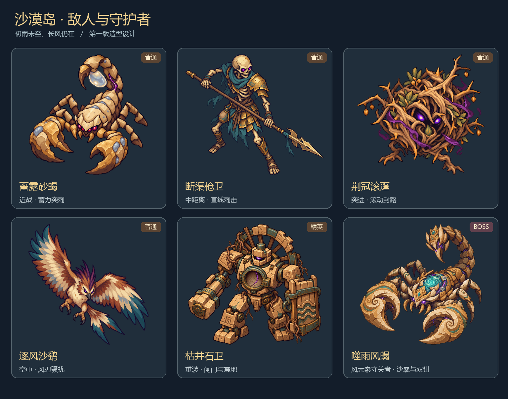

# 沙漠岛设计 V1：愿长风携雨而来

状态：本文为早期 V1 设计档案，保留了当时的 14–18 房目标与美术方向。当前运行版为三层 39 房的 [V12](DESERT_V12.md)；下一阶段的房间、事件与剧情规格见 [沙漠第一章设计](DESERT_CHAPTER_DESIGN.md)。本文的旧规模与尚未实现招式不作为当前试玩规则。

## 主题与视觉

少年希望让枯井重新有水、让旧渠重新流动，让绿洲里的居民、树木和动物度过旱季。沙漠本身保留沙丘、岩壁、耐旱植物和稀疏绿洲的美；风元素恢复后，海上的雨云能沿原来的季节风路径到来。

普通生物因失控风元素而躁动，遗迹守卫因水源枯竭和魔力污染而敌视闯入者。紫色裂纹表示腐化，蓝绿与银白表示原有的风、水和储露构造。敌人败退、解除腐化、机械停机等表现可以替代统一的血腥死亡。

## 敌人阵容

以下尺寸和时间均为制作与试玩起点，后续随战斗测试调整。

| 敌人 | 造型识别点 | 战斗职责与前摇 | 首次出现与后段变化 |
| --- | --- | --- | --- |
| 蓄露砂蝎 | 金砂甲壳、大钳、尾部透明露囊 | 短距离追近；抬尾约 0.7 秒后突刺，落空后有明显停顿 | 前段单独教学；后段与枪卫形成远近组合，精英型先侧移再突刺 |
| 断渠枪卫 | 青灰围巾、空水壶、风向矛尖 | 保持一段距离，矛尖亮起后直线刺击；身体转向后才判定 | 前段引入走位；后段两侧夹击，避免所有枪卫同时出手 |
| 荆冠滚蓬 | 圆形荆根、种荚、中心嫩芽 | 收拢枝条蓄力后滚动；撞上实心柱或墙会停顿 | 中段引入绕柱；后段留下一小段可辨识的短时荆棘区，不堵死所有通路 |
| 逐风沙鹞 | 宽翼、叉尾、蓝绿翼尖 | 绕行后停拍一下，再发出少量风刃；俯冲前影子给出落点 | 中段引入远程压力；后段增加一次换位，弹丸依然被石柱挡住 |
| 枯井石卫（精英） | 空水位盘、背部断水轮、闸门盾、石锤 | 慢速推进；盾牌与重锤动作分开，震地后胸腔短暂暴露 | 后段或支路精英房；最多一只，搭配少量普通怪，不用密集小房围困玩家 |

普通怪预计可见高度约 48–64 游戏像素；沙鹞按翼展定尺寸，阴影表示落点；石卫约 72–88 像素。需要先制作动作，再根据身体底部设置地面碰撞，避免拿整个高大立绘挡住地面移动。

每种敌人至少需要待机、移动、攻击前摇、出手、恢复、受击、败退／死亡。人形与左右移动优先复用一致的镜像步伐；武器动作单独检查握持、攻击范围和判定时刻。生成图仅作为造型原稿，动画切图必须逐个按透明轮廓提取。

## 最终 Boss 候选池

每轮从噬雨风蝎、古渠巨像、沙原猿王中抽取一位守关者。巨像使用震地、风阵、召唤枪卫；猿王使用跃击、投石和召唤滚蓬。风石分别嵌在胸背、胸腔或王冠中，单次通关仍只收集一片风元素。每种 Boss 使用不同场地组合。

## Boss：噬雨风蝎

它原是古绿洲的守护兽。风元素碎片被邪恶势力强行送入体内，令它把原本携带湿润空气的季风扭成持续沙暴。胸背处的蓝绿螺旋石是 Naki 风元素，紫色裂纹表现操纵与痛苦；体内的银色露珠成为剧情提示。

视觉体量约为少年的三倍，双钳像风蚀岩拱，尾甲像旱风之冠。实际碰撞以身体底部为准；双钳、尾击和风刃分别使用独立、可读的判定。

| 阶段 | 招式 | 玩家应对 |
| --- | --- | --- |
| 第一阶段 | 单钳横扫：抬钳、扇形预警、扫击、收招 | 退出扇形或闪避穿过攻击时机，利用收招近战 |
| 第一阶段 | 尾刺：尾尖亮起，地面出现落点圈 | 观察落点，避免站定施法 |
| 第一阶段 | 三道风刃：胸背风石蓄光，向扇形发射 | 利用完整实心柱掩护，风刃不能穿柱 |
| 第二阶段（低血量） | 沙暴移位：风向带先出现，Boss 换位后重复一招基础攻击 | 根据风向留出撤退空间；不要同时叠加扫击、落点圈和密集风刃 |

Boss 场地使用完整实心柱和明确的可破坏障碍两种外观。完整实心柱始终挡弹；只有具有裂纹、破碎动画和已发生破坏状态的障碍，才允许之后的弹丸通过。

击败时先让紫色纹路退去、风石脱离，再表现守护兽伏地沉静、沙暴停止。剧情可以让它恢复为普通守护兽并离场；风石仍由玩家取得，符合收集碎片的主线。

## 岛内规模与地图差异

正式沙漠岛按 **14–18 个房间节点**规划。主路约 10–12 间，另有 4–6 个支路、事件与奖励节点；每次是否探索全部支路由玩家决定。3–5 间只作为早期内部联调，不作为最终岛屿规模。目标时长先定约 20–30 分钟，完成战斗手感和房间联通后再实测。

房间池至少准备沙丘外缘、枯井村口、断渠庭院、风蚀柱厅、埋沙蓄水池、狭长引水渠、升降闸室、沙暴露台、精英守井室、古渠核心十类结构，再添加不同入口方向、掩体配置与尺寸版本。地图结构、障碍和出生点均由房间配置驱动，碰撞与实际绘制使用同一份配置。

| 节点类型 | 计划数量 | 功能 |
| --- | --- | --- |
| 入口与恢复节点 | 2 | 介绍枯井、水源目标，提供中途喘息 |
| 普通战斗 | 6–8 | 新敌人教学、组合与地形变化 |
| 精英 | 2 | 一主一支路，提供高风险选择 |
| 自然／村民事件 | 2 | 疏通小渠、保护幼苗、帮助水车，承担可选剧情 |
| 奖励节点 | 1–2 | 技能或武器选择，与战斗奖励分工 |
| Boss | 1 | 夺回风元素、触发自然恢复 |
| 隐藏节点 | 0–1 | 回访线索或额外奖励 |

每次入岛使用种子组合房间，同一轮保持房间稳定；重返房间不重新刷难度或重复领奖。固定生成入口、Boss 可达路径、恢复点与足够的安全空间，再随机选择其余布局。连续普通房尽量避免相同轮廓、相同门位和同一种掩体摆法。

## 难度推进

难度按照房间在生成图中的深度、房型和已解锁敌人递进，不按玩家来回进门次数递增。

| 进度 | 敌人组合 | 攻击性与地形 |
| --- | --- | --- |
| 前段 | 砂蝎、枪卫逐种教学，每房 1–2 种 | 较长前摇，明显收招；宽敞回避区 |
| 中段 | 引入滚蓬和沙鹞，每房 2–3 种 | 近战逼位加远程骚扰；出现可利用的柱阵与渠道转角 |
| 后段 | 3–4 种普通怪组合，部分房加入 1 只石卫 | 主动绕掩体、分波进场、包抄；给出明确退路 |
| Boss 前后 | 精英房检验学习，Boss 检验节奏 | 通过攻击组合和阶段变化增加难度，保留读招窗口 |

可先把普通怪的追击意愿、有效射程和攻击间隔逐档调整，速度和生命只作小幅增加。前摇应有明确下限；同一时刻的高威胁攻击需要协调，不能让所有怪无间隔齐射。新敌人第一次出现时给予相对简单的环境，后面再混编。具体数量、预算和冷却由试玩确定。

## 各岛地图与自然主题

| 岛屿 | 地图语言与路线变化 | 自然恢复与 CG 的核心画面 |
| --- | --- | --- |
| 风／沙漠 | 沙丘、石柱、井、旧渠、闸门、风向与开阔地 | 长风携雨，枯井复流，沙丘与稀疏绿洲并存 |
| 冰／冰山 | 冰洞、裂隙、冰面滑行、冻结水道 | 阻塞的溪流恢复季节性流动，保留冰雪与寒地生命 |
| 火／赤色岛 | 火山岩、熔岩支流、蒸汽与冷却岩台 | 地火恢复稳定，火山灰中的新芽与温泉重新可亲近 |
| 电／雷雨高原 | 峭壁、导电石、雷击带、避雷地形 | 雷雨恢复节律，避雷与引水设施保护居民和高原生物 |
| 木／森林 | 根系、腐木、孢子、毒沼和层叠林径 | 腐解与生长重新平衡，幼苗从旧木边萌发 |

第六岛的光暗选择和最终国王剧情保留既有主线。自然主题通过水源、作物、居民和生境的变化，解释少年收集力量的目的，并为“力量如何使用”提供具体的人与土地。

## 开场、对话与 CG

完整稿见 [沙漠岛剧情分镜](DESERT_STORYBOARD.md)。本轮已生成一张通关 CG 方向稿，后续应根据故事发生时间调整水量、人物位置和对话留白。

本轮原始透明敌人图、素材清单、生成提示均位于 `Art/DesertBestiaryV1`。CG 位于 `Art/DesertStoryV1`。V8 已为五种敌人与三种 Boss 制作动作图集并接入基础行为，后续根据试玩继续精修朝向、动作衔接、数值和寻路。
