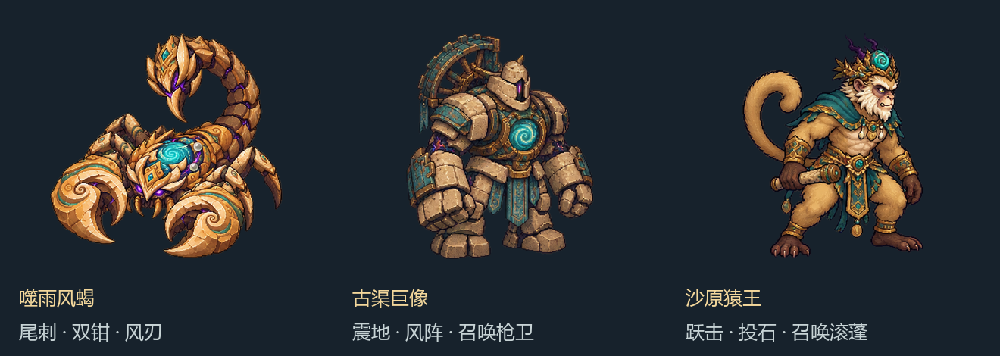
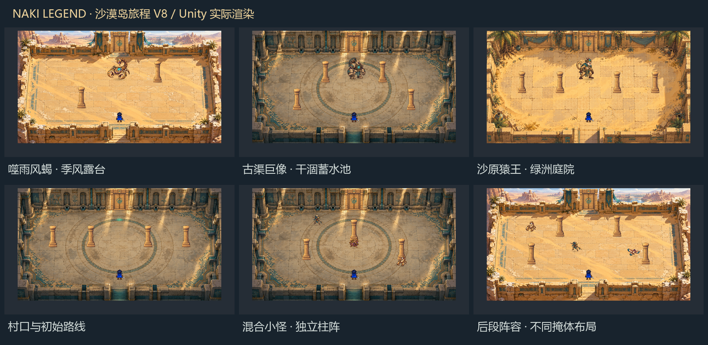

# 沙漠岛旅程 V8：试玩说明

本版已将单房间战斗扩展为一段可以完成的沙漠岛原型：枯井村口出发，探索主路和支路，打败本轮守关者，取回风元素，观看“甘泽归沙”CG，并解锁长风技能。

## 打开场景

- 正常旅程：`Assets/Scenes/NakiTest.unity`。
- 快速测试 Boss：`Assets/Scenes/NakiBossPractice.unity`。直接进入随机守关者场地，使用同一套战斗与通关逻辑。
- Unity 版本为 2022.3.62f3，URP 14.0.12。Game 窗口用 16:9，并调整 Scale 让画面完整显示。

退出 Play 后在 NakiPrototype 组件上可设置 `Boss Override`：-1 随机、0 风蝎、1 巨像、2 猿王。`Journey Seed` 为 0 时自动生成种子；指定非零值可复现同一轮布局。关闭 `Enable Desert Journey` 可回到旧的单房间碰撞测试。

## 操作

| 输入 | 行为 |
| --- | --- |
| WASD | 移动 |
| J，可按住 | 剑击 |
| K | 闪避，短暂无敌 |
| L，可按住 | 消耗光能释放追踪法球 |
| F | 推进对话；在清理完成后的北侧出口选择相邻路线 |
| A / D，然后 F | 路线或奖励界面中选择、确认；也可鼠标点击 |
| M | 查看路线图；查看时暂停战斗 |
| I | 取回风石后释放长风：五发扇形弹丸、近距离击退；消耗 20 光能、冷却 3.5 秒 |
| Esc | 暂停／继续；关闭路线界面或略过对话 |
| R | 重试同一旅程，重新开始并重置升级与碎片 |
| N | 新旅程，重新生成种子与 Boss 候选 |

## 路线与地图

一轮有 **16 个节点：12 个主路节点加 4 个可选支路**。包含普通战斗、精英、恢复点、旧渠事件、奖励与最终 Boss。主路和支路连接结构固定；房间背景和掩体布局通过种子组合，同一轮回访保持稳定。

地图使用四套背景：绿洲庭院、断渠回廊、干涸蓄水池、季风露台；有十六种独立石柱布局，部分增加落石掩体。完整实心柱和落石始终挡弹，移动碰撞使用地面底座。房间绘制与碰撞都由同一份布局生成。

清怪后北侧光标变绿。走近并按 F，可选择前进、回访或进入支路。清过的房间不重新刷怪；恢复、事件与奖励每轮只结算一次。生命、光能和本轮强化在房间间延续。

普通战斗房会从单波增加到后段的多波，逐步加入新敌人，速度与攻击间隔小幅递进；同时蓄力的普通敌人数量受到限制。早期先遇砂蝎和枪卫，中段引入滚蓬与沙鹞，精英房出现石卫。

## 敌人与守关者

五种普通／精英敌人及三个 Boss 均接入了独立动作图集：每种四个移动／拍翼姿势、蓄力、出手、受击和败退，共 64 个姿势。角色原有左右镜像步伐继续使用。

| 敌人 | 当前行为 |
| --- | --- |
| 蓄露砂蝎 | 抬尾预警后短促突进 |
| 断渠枪卫 | 寻找近似水平的刺击路线，前摇后直线出手 |
| 荆冠滚蓬 | 蓄力滚动冲撞，撞到地面障碍停顿 |
| 逐风沙鹞 | 绕行、保持距离、发射少量风刃，寻找掩体外的射线 |
| 枯井石卫 | 重击与小扇形弹幕，收招时失去护甲减伤 |
| 噬雨风蝎 | 尾刺落点、钳击、扇形风刃；低血量缩短间隔并增加弹幕 |
| 古渠巨像 | 近身震地、较宽风阵、召唤枪卫；低血量强化招式 |
| 沙原猿王 | 跃向预警落点、投石扇形、召唤滚蓬；低血量强化招式 |

每轮最终 Boss 从三者中抽取一个。三者体内／冠上的风石是同一主线碎片的不同旅程呈现，单次通关仍只获得一片风元素。

加入敌人生命条、命中数字、受击变色、败退淡出、轻微震动与简短合成打击音。弹丸与剑击均尊重柱身掩体；Boss 死亡后清理召唤物，再进入通关流程。

## 自然与剧情

入口对话交代失去雨云的季风和枯井。旧渠支路以疏通渠道、修好水车卡槽和给树根留水的对话结算，并恢复少量状态。Boss 解放风石后，先在场景里讲述沙暴散去，再转入“甘泽归沙”插画。

CG 和对话已能在游戏中播放。取回风石后仍可回访未探索支路，试用长风；按 N 开始新的旅程。

## 验证与当前边界

Unity 2022.3.62f3 / URP 通过 73 项运行检查，覆盖 50 个种子的连通图、全部布局通路、敌人出生点、波次、回访状态、奖励防重复、八种敌人动作与预警、三种 Boss 招式和阶段、弹丸击杀后的安全结算、风技能与 CG、重试和新种子、Boss 试炼以及完整柱身挡弹。图集生成脚本另行验证了 64 个姿势的透明边距与残片。

实际相机渲染见下图，未包含 OnGUI 界面层；最终键盘手感与数值需要继续试玩调整。

本版是沙漠岛流程原型。敌人主要使用左右镜像动作；寻路仍为简单绕障；地图为背景加独立配置掩体。旧渠事件通过对话与状态恢复结算，尚无完整水车修复动画；击败后的自然恢复由 CG 呈现。进度只保留在当前 Play 会话，正式存档、更多岛屿、武器掉落与切换、完整光暗主线留待后续阶段。

本轮美术使用内置 imagegen 生成，原图与提示保存于 `Art/DesertJourneyV8`。`Tools/build_journey_assets_v8.py` 按透明连通轮廓提取，不按等分格子盲切；需要 Pillow、numpy、scipy。
