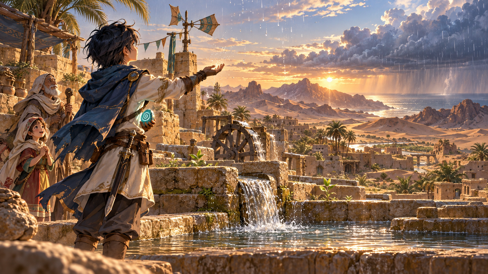

# 沙漠岛剧情分镜：愿长风携雨而来

这一岛让玩家看见“缺水影响了谁”，再用战斗与环境变化兑现少年的承诺。叙事围绕风、云、井、水渠、树根与村落，不以击败一个强敌的庆功画面结束。

## 1. 抵达：井底余凉

画面：晚风掠过空井，水车停在半转的位置。孩子把壶底最后一点水倒给一株耐旱幼苗，老人收起干燥的汲水绳。远处仍有美丽的沙丘，危险来自异常持续的旱风。

- 老人：“从前，风会把海上的云带过山口。如今，它只卷走井底最后一点凉气。”
- 少年：“井已经这样干了多久？”
- 老人：“久到孩子只听过雨的名字。”
- 少年：“那就让他们亲耳听一次。我会让风重新认得回家的路。”

随后才交代风石与古渠遗迹的线索。国王的任务是起因，村庄里缺失的水声成为少年自己愿意前进的理由。

## 2. 支路事件：留一瓢给树根

画面：玩家疏通一段被沙堵住的小渠，修复水车的卡槽。恢复少量存水并开启邻近通路。事件可以给予恢复或小奖励，但不能要求玩家为了通关必须选特定道德选项。

- 孩子：“要是找到水，能先给我的小树喝一口吗？”
- 少年：“好。也给你和村里的人留一份。”
- 孩子：“那等树长大了，路过的人就有地方乘凉了。”

环境线索：小砂蝎的露囊、旧墙上的风向符号、空掉的水位盘，逐渐提示守护兽和水源的关系。

## 3. Boss 前：被困住的风

画面：胸背风石把云层扭成干燥旋流，风蝎体内的露珠反复凝成又被蒸散。古壁画显示，它曾守在渠口，身后是缓慢转动的水车。

- 少年：“壁画上的你，守着的原来是水。”
- 少年：“我会取出那块石头。让你和这片土地，都能喘一口气。”

Boss 以前摇、呼吸与风声表达痛苦，不必让它像反派一样长篇解释。战斗中风石蓄光和紫纹加深，分别对应风刃与失控阶段。

## 4. 击败：第一滴

镜头顺序：

1. 双钳落下，紫纹熄灭，蓝绿风石脱离；风蝎伏地，呼吸稳定。
2. 一粒悬在尾尖的露珠终于落入旧渠，沙暴远离村庄。
3. 镜头转向山口，原本绕开的云开始向内陆移动；风向标重新指向季风的方向。
4. 少年伸手接住第一滴雨，孩子抬头，老人松开手中的空水壶。

- 孩子：“这是……雨吗？”
- 少年：“嗯。风把它带回来了。”

## 5. 通关 CG：甘泽归沙

时间可以推进到雨后稍晚：村民与少年共同疏通的水渠开始复流，水车缓慢转动。原有绿洲得到补给，新的幼苗只出现在渠道与树荫附近。远景仍是沙丘、耐旱植被和稀疏聚落。

- 孩子：“井里有声音了！”
- 少年：“是水回来了。第一瓢，记得留给树根。”
- 老人：“愿这阵风，也能吹到别的干渴之地。”
- 少年：“愿长风所到之处，皆有甘泽。”

CG 名称可用“甘泽归沙”。镜头里的幸福来自可见的小事：湿润的石阶、重新取水的居民、树根旁的一片新叶，而非满屏力量与庆功特效。

## 后续制作约束

- 对话要短，关键一句后让水声、风声和画面承担情绪。
- CG 的少年保持黑发、蓝披风、浅色衣服、佩剑；插画精度高于实战像素角色。
- 沙漠生态始终保留。初雨与通渠需要分清时间，不能一滴雨瞬间让所有枯树长成森林。
- 若玩家选择暗路线，沙漠愿望也可以成立；贤者之石的获取与消耗由既有道德主线承接，不把关心土地限定为某一种属性。
