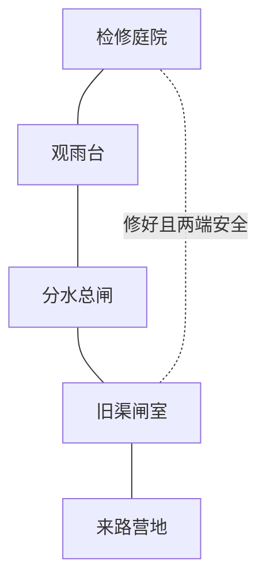

# 旧渠闸室样板试玩说明

独立样板 S1，2026-10-27；V14 已接入正常主线。已实现五房跑图、两波战斗、清沙修闸、一次性元素奖励、双端安全捷径，以及干渠到通水和初雨的回访变化。原 39 房沙漠由 NakiTest 场景进入，V14 已在最终 Boss 后接入这五间归渠水道，完成修渠后播放 CG，见 [主线说明](ADVENTURE_V14.md)。

## 打开与操作

Unity 2022.3.62f3 中打开 Assets/Scenes/NakiGatehouseSample.unity，等待编译后 Play。也可用菜单 Tools → Naki Legend → Open Old Canal Gatehouse。场景已由 Unity 自身保存并重新打开验证，不需要手动勾选组件选项。

WASD 移动，J 当前武器，K 闪避，F 交互，H 换武器，B 行囊，M 地图，1 / 2 药剂。样板明确开放 L 元气弹、U 风之刃、I 护身风波，并携带免费短剑与风牙法杖，方便比较资源与自动瞄准。正式沙漠的技能仍按原进度学习。

R 重新开始本轮，N 用新种子重开；样板布局固定，种子只影响备用生成点。清沙时 Esc 取消，转轮时 Esc 跳到完成状态。对话、行囊和操作演出期间，战斗、恢复和冷却不推进。

## 推荐试玩路线

1. 从来路营地向北走门，进入旧渠闸室，清理两波敌人。第一波是两只砂蝎、两名枪卫；第二波为两只砂蝎、枪卫和沙鹞。
2. 清理后，北门与来路打开。可以直接向北继续探索，也可以靠近两处沙堆按 F，清理后再靠近手轮按 F。
3. 手轮只修一次，留下价值 20 的元素结晶；元素已满时不自动拾取，离开回访仍保留。修理不扣光、暗或元素之力，不再附送另一份泛用事件奖励。
4. 沿北门进入分水总闸，靠近总阀按 F。已修复的水渠开始有少量存水，未修的闸室保持干燥。
5. 向东进入观雨台，再向南清理检修庭院。修闸且两端战斗都清理后，庭院西门与闸室东门的检修捷径同时开放。
6. 经捷径回到闸室，检查沙堆已移除、结晶没有复制、手轮状态保留和水渠变化。观雨台铃台可预览初雨，再回访查看更明亮的水流与细雨。

观雨台的初雨是样板环境预览。正常主线在 Boss 后取得风石，修好闸室、打开总闸和清理庭院后，风铃推进雨季与通关 CG。独立样板不发风石；第二岛尚未开放。

修闸前仍可沿北侧环路到达另一端。M 地图只查看探索记录；铜色连线表示检修捷径尚未开放，未知房间仍有探索迷雾。

## 素材与动画

新增青铜手轮、沙堆与可拼接干渠，原稿及精确生成提示在 Art/GatehouseV13。手轮使用固定底座和独立轮面，转轮时轮面在投影平面内旋转；完成后保持最终角度，回访重新构建相同状态。渠道使用贴图和轻微流纹，当前不做流体模拟。

短操作沿用现有角色姿态与物件动画，专门的清沙蹲下动作尚未制作。原像素角色、V11 手掌握持、V12 资源与背包机制继续使用。所有新美术通过内置 imagegen 制作，透明原稿保留；切片由 Sprite 元数据定义，源 PNG 不改写。

## 验证与范围

样板通过 81 项 Unity 检查：实际过门、安全落点、两波战斗、跳过修理、取消清沙、部分修理回访、连续交互、满资源结晶、收集后回访、两端开闸、总阀与雨景、碰撞不累积、死亡与重开，以及真实 1920×1080 HUD / 地图截图。

另通过 24 项真实 Play 程序集重载检查，覆盖倒地时重载、存活时重载、之后持续死亡和重开攻击。验证脚本与结果在 Validation/GatehouseV13；原沙漠回归结果同目录单独记录。

场景构建同时规范化保存了 Boss 练习与雷元素试炼的模式字段。正常主线支持安全房存档与继续旅程；独立样板不覆盖正常存档。

蓝色营地毯和圆环装饰已移除。下一步按主线试玩反馈继续细化房间身份、事件与布局。四个支线、三套 Boss 剧情和雷雨高原目前仍按设计稿逐步制作。
