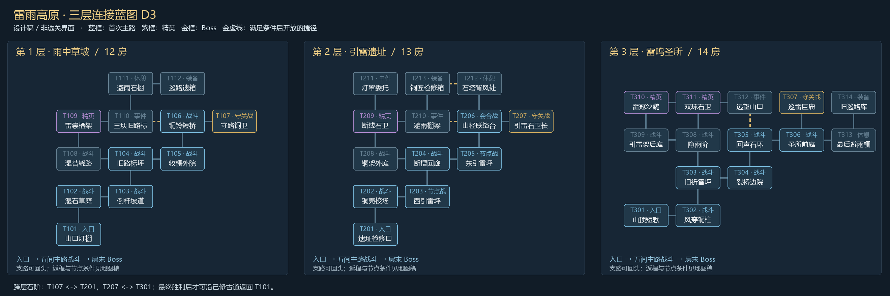

# 雷雨高原 D3：房间连接与场地模块

状态：2026-10-27，设计蓝图，未接入游戏。承接 [D2 的 39 个房间身份](THUNDER_PLATEAU_DESIGN.md)，剧情见 [D3 剧情](THUNDER_STORY_D3.md)，Boss、装备与资源见 [D3 战斗](THUNDER_COMBAT_D3.md)。图中的房间方框是制作蓝图，实际游戏仍沿门、短廊和石阶探索。

本稿把 D2 的主路与环路要求展开为一个可验证的基准连接种子。位置与连接记录在 [room-graph.json](DesignData/ThunderPlateauD3/room-graph.json)；数据位于 Docs，不会被当前 Unity 运行代码加载。

## 三层布局

实线为普通通道，金色虚线为清理后开放的捷径。第一层由低处灯棚向草坡上行，第二层绕着两个引雷节点展开，第三层横过石环再上山顶；不同层使用不同场地模块，不仅换地砖颜色。

| 层 | 首次主路 | 支路价值 | 捷径开放条件 |
| --- | --- | --- | --- |
| 雨中草坡 | T101 → T102 → T103 → T104 → T105 → T106 → T107 | T104 向西进绕路和精英，之后到路标、营地与装备箱 | T110 ↔ T106：T106 与 T109 均已清理；接近时显示“修通短桥”并 F 打开一次 |
| 引雷遗址 | T201 → T202 → T203 → T204 → T205 → T206 → T207 | T204 西侧进入外庭与精英；分支有棚梁、灯罩；营地靠近联络台 | T210 ↔ T206：T206 / T209 已清且两节点复位；T213 ↔ T212：T206 已清，打通检修便道 |
| 雷鸣圣所 | T301 → T302 → T303 → T304 → T305 → T306 → T307 | T303 向北进入两间战斗与两精英的环路，可提前回头；T306 东侧是最后营地与装备 | T312 ↔ T305：T305 / T311 已清，开回声石门；两端均可检查条件 |

捷径只缩短已完成路段的回访，不跳过第一次关键教学，也不把“扶三块路标”等可选事件变成主线钥匙。捷径未开时显示实体栅门或封桥与原因，不伪装成黑色空洞。条件满足后 F 只用一次，此后普通走门。

相邻格子只有在 JSON 明确列出通道时才有门，不能因为坐标挨着就全打通。例如 T314 邻近最终 Boss 的格子，但两者之间没有通道；最后营地能整理后直接去前庭，装备箱不能绕进 Boss 背后。

本蓝图共有 39 房、41 条层内连接、2 条跨层石阶连接。每层仍有七个必须按顺序首次抵达的主路房，共 21 房；支路可提前走，但捷径条件要求后侧主路清理，不能从侧面提前跳过节点或 Boss。

## 第一次走图时，玩家会怎样行动

草坡先给两种敌人，再给落雷地标；T104 才出现第一处分岔。向主路走可以较快见到铜卫；走支路会有精英、路标、休憩与装备，但也要回到 T104 推进。T106 清理后开放短桥，使后来回营地不再绕远。

遗址的西 / 东节点分别在 T203 / T205，主路经过，不需要翻完整地图找两把钥匙。节点战后免费复位；T206 的巡路员解释上山目标。T207 前封锁明确显示缺哪一节点，既有路径可原路回去，不把玩家困在 Boss 门里。

圣所主路多一点方向变化，两个精英放在独立支路环上，玩家可以只打一场再回头。T313 从 Boss 前庭一门到达，是整理与保存点；T314 为安全装备房。进入 T307 必须先清 T306，不用做四支线，不用抽到特定武器。

## 六种场地模块

| 模块 / 用途 | 可走空间草案 | 障碍与门的安排 | 可互换变体 |
| --- | --- | --- | --- |
| G1 湿石宽庭，T102 / T105 | 18 × 10 | 两侧低石，中间宽退路；门在边线中段，安全带内无石 | 左右石错位 / 破棚偏北；保证所有门彼此可达 |
| G2 倒杆折院，T103 / T108 | 16 × 12 | 折线边界，但两边都有绕路，倒杆不横封入口 | 铜杆在外侧 / 低墙朝南；不做一格窄缝 |
| G3 铜铃桥坪，T106 | 20 × 10 | 中央视觉上是桥面，两翼是连通的石台；两侧都可闪避 | 桥朝东西 / 转为南北；水沟仅在可走边界外 |
| R1 双侧检修台，T203 / T205 | 18 × 11 | 中路空，导能槽贴一边，手柄在另一边；槽不会横断唯一出口 | 东槽 / 西槽；节点位置可变，预警区与手柄保持距离 |
| R2 铜架环庭，T204 / T208 | 20 × 12 | 两组短掩体，外圈与中心互通；不强制绕完整圈 | 分裂矮墙 / 低铜架；高物件移出镜头主要视线 |
| S1 回声石环，T303 / T305 / T308 | 18 × 12 | 环纹只作地面，中央可走，边缘留两处低石 | 缺口方向变化；裂纹不变成无预警陷阱 |

入口、休憩、事件、装备与三场 Boss 各有独立摆设，不拿六个战斗模块硬充所有房间。Boss 场地的尺度与机制按战斗稿单独制作。变体可以改变轮廓与掩体；敌人出生点、手柄、门和技能教学台随变体重新验证。

墙体、地面、门框、栅门、低石、手柄、导能槽、草丛和灯均为独立物件。环境概念图确定材质与色调，不直接作为全屏地图贴图。草木和高原远景主要在外围，低饱和地面留给角色、弹幕与预警。

## 门口与战斗边界

门净宽至少 1.8 单位，门内留宽 2.4、深 2 的安全带，不放掩体、敌人刷点、药剂箱、手柄和教学台。双脚进入房内缓冲区后才提交换房，再关门和播放刷点预警；如果玩家仍与栅门重叠，先找到房内安全站点，不能以挤压扣血解决。

怪物以身体半径为边界，不进入通道；冲刺分步检查，封门前收回越界敌人。飞弹可以打到栅门和低石，关闭的门不单纯画一条色块；封门状态在视觉和碰撞上同帧生效。通道内不刷怪，也不保留上个房间残弹。

小地图只显示已走过和相邻未知房，设计图中的完整房型不在开局公开。大地图只查看，不点击传送。当前房用外框与箭头同时表示，已清理房用实心，未清理用空心；补给、已开石阶、未完成节点与最终目标有各自图标，避免只用相近颜色区分。

## 任务指向与保存

通向下一层的门前地面有石阶、竖向光粒与“引雷遗址 / 雷鸣圣所”文字；靠近显示 F 下一层。清房时只提示方向，不强制弹出地图。未完成的手柄在房内图标旁保留叹号，完成后变成稳定铜环标记。

每层入口、已清理休憩房与清完的 Boss 房均可成为安全保存位置。选择配置、扶标记、修棚、复位节点和打开捷径提交进度后请求安全保存；不存半场敌人与尚未完成的持续交互。失败重试回到最近安全点，不回到地图菜单重新选房。

最后 Boss 胜利后给一次明确“沿已修古道回山口”的 F 确认，使用专用返程事件回 T101；这条返程不计普通门连接，也不允许战斗中使用。它只在完整接入岛屿存档和尾声后启用。

## 随机变化的边界

第一版先固定本连接种子，做完通行与节奏再增加变化。下一批种子允许整层坐标旋转 / 镜像、兼容模板轮换与可选支路的挂接变化，保证每个房身份本轮固定，节点先后、主路七房和层末 Boss 不变。不同层使用不同模块分配和配色，不能三层只复制同一矩形房。

生成后检查：每层入口能到所有房；门为双向且只跨相邻格；无重叠格、悬空门或连接穿房；删去任一尚未开放捷径仍有主路；首次进入主路后侧不得从支路绕过教学 / 节点；Boss / 石阶只在对应条件后开放；道具、出生点与门缓冲区不相交。

连接数据检查只能证明图上能走，实际 Unity 的身体半径、栅门和掩体还需按 [两房原型验收](THUNDER_PROTOTYPE_SPEC.md) 检查。纸面布局不作为“不会卡人”的运行证明。
