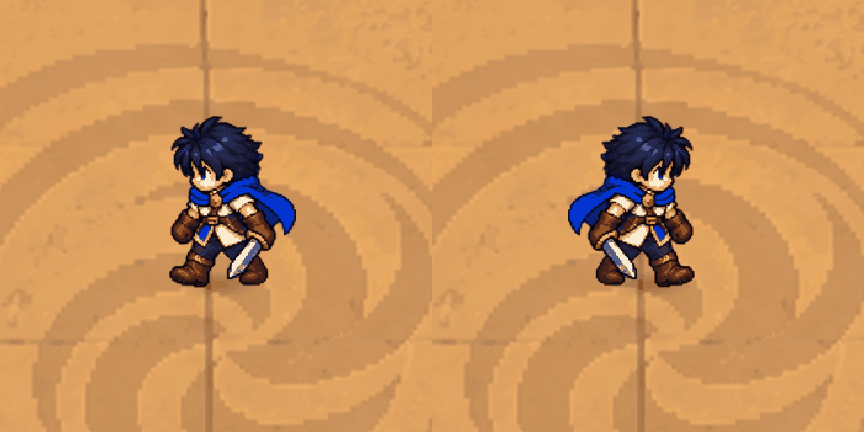

# Naki Legend

Unity 2D 地牢战斗原型。当前已有沙漠测试房间、近战、追踪法球、闪避、两只小怪和风蝎 Boss。游戏角色使用像素动作素材，CG 与对话图计划使用精细插画。

## 打开与运行

1. 安装 **Unity 2022.3.62f3**，在 Unity Hub 中添加本仓库根目录。
2. 等待 Package Manager 安装依赖和脚本编译。项目使用 **URP 14.0.12 / Renderer2D**。
3. 打开 `Assets/Scenes/NakiTest.unity`，点击 Play，再点击 Game 窗口获得键盘焦点。
4. Game 窗口建议用 16:9，并调整 Scale 让画面完整显示。

入口场景已保存角色脚本，首次克隆不需要手动挂组件。`SampleScene` 保留为原始模板场景。

| 按键 | 操作 |
| --- | --- |
| WASD | 移动 |
| J，可按住 | 剑击 |
| K | 闪避 |
| L，可按住 | 追踪法球 |
| Esc | 暂停／继续 |
| R | 重新开始 |

## 本次修复

左走原素材的腿部变化不明显，现改为镜像复用已确认的右走六帧循环。左右保持相同的步伐相位；转身会正确恢复翻转状态，残影也会复制对应状态。保留上一轮的独立切图、透明边距、落脚点对齐和连续移动坐标。

## 结构

- `Assets`、`Packages`、`ProjectSettings`：可直接打开的 Unity 工程。
- `Art`：必要的原始动作表、提取坐标、生成记录与修复预览。
- `Tools/build_hero_atlas_v5.py`：按透明轮廓提取图集，需要 Pillow、numpy、scipy。输出到 `Art/PolishedHeroV5`，运行时读取 `Assets/NakiPrototype/Resources/NakiArt` 内的图集。
- `Validation/LeftWalkV6`：本次运行记录和回归检查脚本。
- [下一阶段计划](Docs/ROADMAP.md)：先完成可反复试玩的沙漠岛短流程。

仓库排除 Library、Temp、Logs、UserSettings、历史 ZIP 和测试逐帧截图。当前仍是原型：敌人使用占位图，房间切换、掉落、剧情光暗分支与存档尚未实现。

## 验证

本次在 Unity 2022.3.62f3 / URP 完成 34 项运行检查，包含六个左右步伐逐帧镜像对应、转身状态恢复、连续移动、剑击时机、闪避、施法、重开和 Boss 胜利。图集检查覆盖 56 个姿势的主体完整性、边距和落脚线。

`Validation/LeftWalkV6/LeftWalkSmoke.cs` 是开发检查脚本，默认不参与游戏编译。需复跑时，将它临时复制到 `Assets/Tests/Editor`，用 Unity 的 `-executeMethod NakiLeftWalkSmoke.Run` 执行；它会创建测试场景、切换 Play、输出报告并退出编辑器，应在独立工作副本执行。
