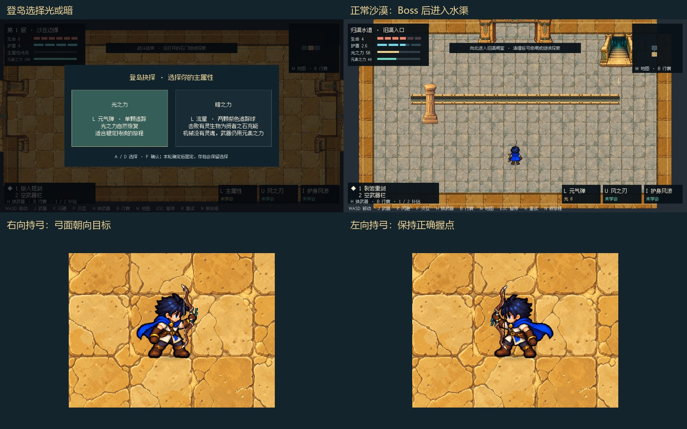

# Naki Legend

Unity 2D 地牢试玩，当前 **V14**。沙漠岛三小层共 39 房，四向走门探索，包含护盾、分阶段学习的光暗 / 风技能、独立主属性与元素资源、自动瞄准、六格行囊和三种最终 Boss。登岛选择光 / 暗，安全房自动存档；Boss 后进入五房归渠水道，最后播放 CG。保留 V10 精细开场与 V11 武器握持修正。

**第二岛“雷雨高原”完整可玩首版已加入**：三层 39 房、双引雷节点、失联巡路员、三位 Boss、六件新武器、雷标 / 跃电与“灯下有归人”尾声。停止 Play 后，用 **Tools → Naki Legend → Play → 2 Thunder Plateau Adventure** 打开，再点击 Play。配置页可从任意一层或任意 Boss 开始，F5 / F9 使用独立存档，T 整理元素技能。沙漠收尾后也可在望台西侧风铃 F 乘船接续。详见 [第二岛试玩与数值说明](Docs/THUNDER_CHAPTER_V1.md)。

## 打开试玩

1. Unity Hub 添加本仓库根目录，使用 **Unity 2022.3.62f3**。工程采用 URP 14.0.12 / Renderer2D，等待资源导入与脚本编译。
2. 打开 `Assets/Scenes/NakiTest.unity`，点击 Play。有存档会自动继续，F9 也可读取；N 开始新旅程。Game 窗口建议 16:9。开场约 74 秒：F 全文 / 下一幕，空格暂停，Esc 跳过。
3. 清完波次后沿打开的门探索；M 地图只查看，不传送。击败前两层守渠者后，找到阶梯，**靠近按 F 前往下一层**。第三层最终 Boss 在风蝎、巨像、猿王中抽取。
4. Boss 练习：`Assets/Scenes/NakiBossPractice.unity`；风克雷练习：`Assets/Scenes/NakiElementTrial.unity`；开场预览：`Assets/Scenes/NakiOpeningPreview.unity`。

已有 SampleScene + NakiPrototype 组件也能运行。更新后先退出旧 Play，等待编译完成，Clear 清除 Console 历史错误，再重新 Play。Play 中重新编译脚本会重建缓存，并优先恢复最近的安全房存档。

| 输入 | 操作 |
| --- | --- |
| WASD | 移动，清房后走门自动换房 |
| J / K | 当前武器攻击 / 闪避 |
| L / U / I | 学习后使用主属性技能（光元气弹 / 暗流星）／风之刃／护身风波 |
| H | 切换携带的两把武器 |
| F | 交互、学技能、拾取、开补给、使用阶梯、推进对话 |
| B | 打开 / 关闭行囊，暂停战斗 |
| A / D，F，G | 行囊中选择、装备到当前栏、丢弃；可点击装备到指定栏 |
| 1 / 2 | 使用清泉药剂 / 元素药剂 |
| M | 查看 / 关闭探索地图 |
| Esc | 暂停、关闭界面、跳过对话 / 开场 |
| 空格 / V | 开场暂停；暂停菜单 V 重播开场 |
| F5 / F9 | 安全房保存 / 读取最近存档 |
| R / N | 同种子重开 / 新旅程；继续原进度用 F9 |

## 本轮修改

- 门框与青铜栅门、门口障碍禁区、安全落点和独立换层阶梯，修复第二层入口夹住玩家的问题。
- 光之力供元气弹，元素之力供武器和风技能。普通敌人 / 精英 / Boss 分别掉落 8 / 20 / 40 元素结晶，靠近自动拾取，满时留地。暗角色学习流星，击败有灵生物充能；完整暗线剧情后续制作。
- 全方向自动锁定可见敌人，近战、法杖、弓、定向技能不用手动调整朝向；实体掩体仍挡弹。远程武器有不同散布。
- 三层独立平铺材质、中文资源栏、明确的层数和交互提示。B 行囊提供两把携带 + 四把备用武器、属性详情、替换 / 丢弃和药剂。
- 精英身份符环与雷印破势；Boss 真实范围预警、蓄力招式、收招提示、45% 血量转阶段，以及死亡后的危险清理。
- 修复 Play 中脚本重载导致倒地 `Defeated` 动画字典丢失并持续刷错；补充死亡、重开和真正的程序集重载验证。

当前光暗、存档、平衡与水渠主线说明见 [V14 修改说明](Docs/ADVENTURE_V14.md)；[V12 说明](Docs/DESERT_V12.md)保留为历史。本轮通过 51 项光暗与存档检查、21 项存档脚本重载检查、398 项水渠主线整合检查，以及 3,121 项基础回归检查（含 1,404 个实际进门落点）；独立水渠另通过 81 项检查。结果见 `Validation/AdventureV14` 与 `Validation/CanalEpilogue`。

## 独立旧渠闸室样板 S1

打开 Assets/Scenes/NakiGatehouseSample.unity，或菜单 Tools → Naki Legend → Open Old Canal Gatehouse。五个实际房间形成环路：清理闸室两波敌人后，可清沙转轮、获得一次20元素结晶，再沿北路打开总阀、绕到另一端清理庭院，开放检修捷径并回访通水景象。

样板已开放三技能和两把武器用于比较，正式沙漠仍按进度学习。满元素时结晶留地；清沙 Esc 取消，转轮 Esc 跳过。运行进度保留在本轮，R / N 重开会重置。通过 81 项样板检查与 24 项真实脚本重载检查，见 [试玩说明](Docs/GATEHOUSE_PLAYTEST.md)。

## 雷雨高原两房可玩原型 S1

菜单 **Tools → Naki Legend → Open Thunder Plateau Prototype**，或打开 Assets/Scenes/NakiThunderPrototype.unity。选择光、暗或无技能零元素预设，A / D 选择从草坡或引雷坪开始，F 进入。两房用实际门廊往返，清理后免费复位铜手柄，检查风克雷、普通雷弹与落雷、奖励与回访。

F5 / F9 使用独立的 thunder-prototype-v1.json，不读取或覆盖正常沙漠旅程；N 打开原型配置。见 [详细试玩说明](Docs/THUNDER_S1_PLAYTEST.md)。S1 保留为历史机制实验，完整三层请使用新的 NakiThunderChapter 场景。

## 第二岛设计：雷雨高原

[D2 三层详细设计](Docs/THUNDER_PLATEAU_DESIGN.md) · [两房原型规格](Docs/THUNDER_PROTOTYPE_SPEC.md) · [环境、巨鹿和两类小怪概念图](Art/ThunderPlateauD2/README.md)。三层 39 房已经接入，沿门探索，用风应对雷，修复引雷设施，让灯匠等到巡路员归家。

D3 设计依据：[剧情对白](Docs/THUNDER_STORY_D3.md) · [三层连接蓝图](Docs/THUNDER_MAP_D3.md) · [三场 Boss、六把武器与技能](Docs/THUNDER_COMBAT_D3.md)。首版完整连接、节点、任务、技能配置和跨岛独立存档已经实现；实际内容与当前边界以 [第二岛 V1](Docs/THUNDER_CHAPTER_V1.md) 为准。

## 开场与美术

下一阶段设计 D1 已整理：[沙漠 39 房与四个事件](Docs/DESERT_CHAPTER_DESIGN.md) · [闸室样板规格](Docs/DESERT_GATEHOUSE_SAMPLE.md) · [Boss 对白与演出](Docs/DESERT_BOSS_STORY.md) · [雷雨高原概念](Docs/THUNDER_PLATEAU_CONCEPT.md)。闸室已作为独立样板实现，整章房间池、其余事件和新岛仍按设计逐步制作。

六幅精细插画构成 11 幕开场，从神鸟传说、元素碎裂、王宫授命，到船头启程、枯井村落和少年为幼苗留水。包含推进、叠化、字幕、环境声与片名；当前无真人配音。剧情围绕修渠、居民饮水与恢复沙漠雨季展开。

[开场分镜](Docs/OPENING_V10.md) · [握持修复](Docs/GRIP_FIX_V11.md) · [V12 美术原稿与提示](Art/DesertV12/prompts.json) · [后续计划](Docs/ROADMAP.md)

本轮生成美术使用内置 imagegen，保留原稿和精确提示。中文字体为 Fusion Pixel，授权见 [第三方说明](THIRD_PARTY_NOTICES.md)。

安全房存档可跨 Play 会话继续。其他岛屿、完整光暗剧情、七元素关系与更多动作演出逐步制作。旧文档保留为历史，沙漠规则以 V14、第二岛以雷雨高原 V1 试玩说明为准。
